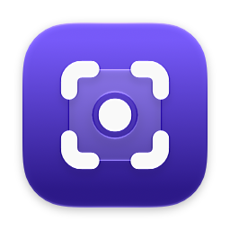
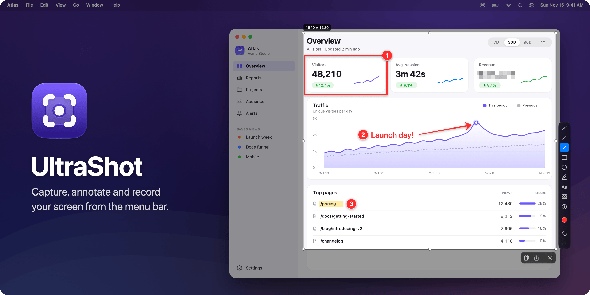
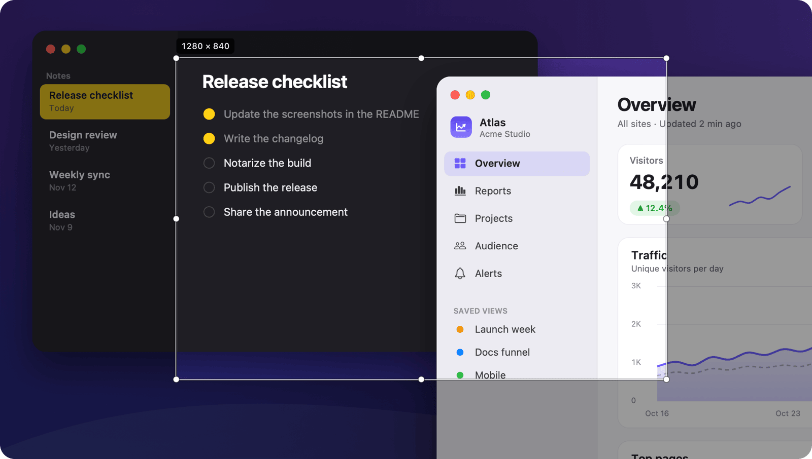
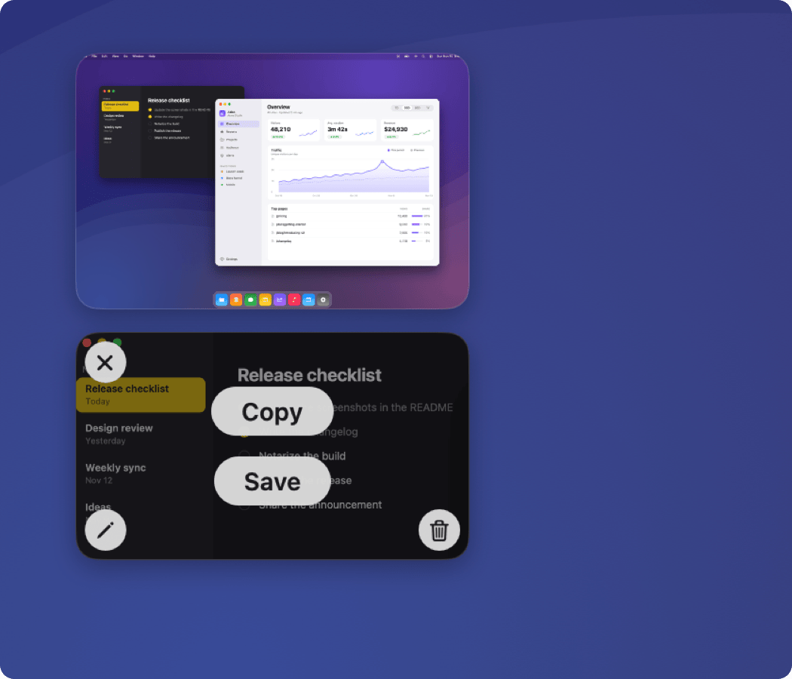
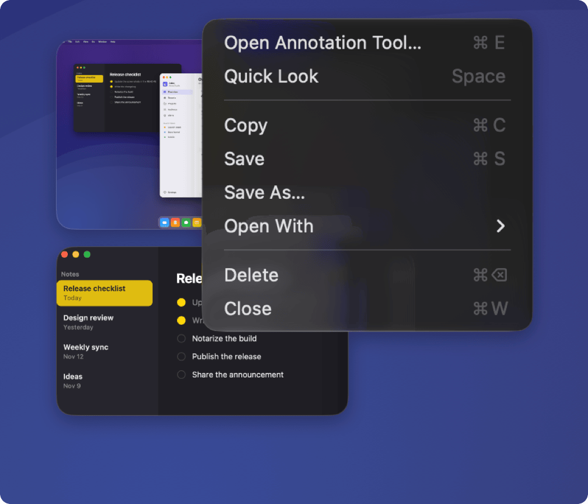
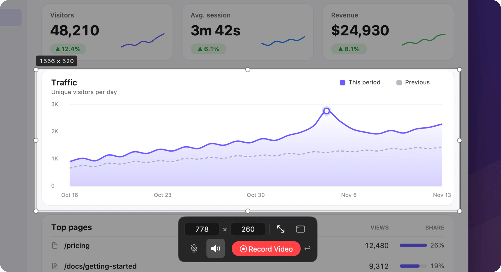
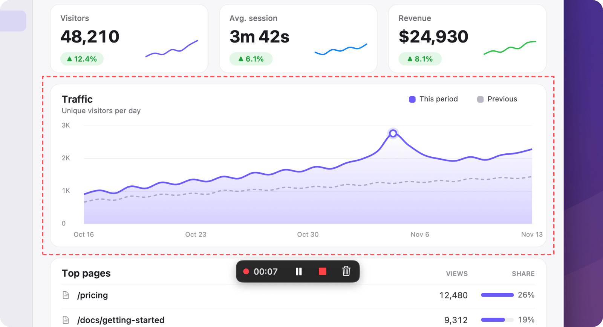
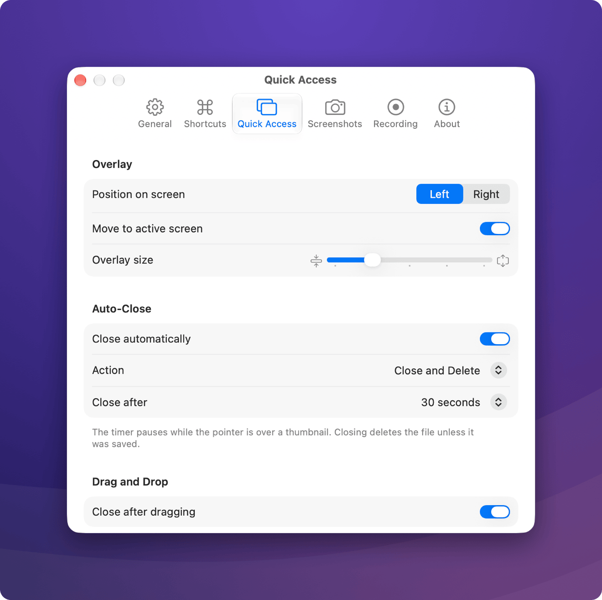

<div align="center">



# UltraShot

**Capture, annotate and record your screen from the Mac menu bar.**

[](#requirements)
[](#requirements)
[](https://www.swift.org)
[](https://github.com/christiancuri/ultrashot/releases/latest)
[](LICENSE)



</div>

## Download

**[Download the latest release](https://github.com/christiancuri/ultrashot/releases/latest)**: open the `.dmg` and drag UltraShot to Applications.

- Signed with a Developer ID and notarized by Apple, so it opens without Gatekeeper warnings.
- It lives in the menu bar only, with no Dock icon.
- Updates itself through [Sparkle](https://sparkle-project.org). You can turn automatic checks off in Settings › General.
- On first launch, grant **Screen Recording** when asked. **Microphone** is only requested the first time you record with the mic on.
- To use ⇧⌘3, ⇧⌘4 and ⇧⌘5, turn off the macOS screenshot shortcuts in System Settings › Keyboard › Keyboard Shortcuts › Screenshots. Settings › Shortcuts tells you when they are still on.

### Requirements

macOS 26 (Tahoe) or later on an Apple Silicon Mac (M1 or newer).

## Features

- **Fast captures.** Capture an area, a window or the full screen. The screen freezes the moment you press the shortcut, so menus and hover states stay put while you select.
- **Clipboard first.** Every screenshot lands on the clipboard right away, ready to paste.
- **Quick Access thumbnail.** A thumbnail slides in at the corner of the screen: hover it to Copy, Save, Annotate or Delete, drag it straight into another app, or right-click for Save As…, Open With and Quick Look.
- **Nothing piles up.** Captures live in a temporary folder until you keep them. When a thumbnail closes, unsaved files are deleted. Auto-close closes it after 5 seconds to 10 minutes and either deletes or saves the file.
- **Lightshot-style annotation.** Capture Area & Annotate keeps the toolbars attached to the selection: pen, line, arrow, rectangle, ellipse, marker, text, blur and numbered counters, with colors, sizes, undo and redo. Resize the selection at any time; the export is cropped to it.
- **Screen recording.** Record an area, a window or the whole screen to MP4 at 24, 30 or 60 fps, with system audio and your microphone on separate tracks. Pause and resume, then stop from the HUD, the menu bar or the shortcut.
- **Fits in.** Saves to the folder you choose with your own file name template, PNG or JPEG, optional sRGB conversion and Retina downscaling, launch at login and a shutter sound you can turn off.

<table>
  <tr>
    <td width="50%"></td>
    <td width="50%"></td>
  </tr>
  <tr>
    <td align="center"><sub>Drag a selection on the frozen screen; the size follows the pointer</sub></td>
    <td align="center"><sub>Quick Access thumbnails with hover actions</sub></td>
  </tr>
  <tr>
    <td></td>
    <td></td>
  </tr>
  <tr>
    <td align="center"><sub>Every action on a right-click</sub></td>
    <td align="center"><sub>Record Screen: pick an area, set its size and audio, record</sub></td>
  </tr>
  <tr>
    <td></td>
    <td></td>
  </tr>
  <tr>
    <td align="center"><sub>Recording HUD with timer, Pause, Stop and Discard</sub></td>
    <td align="center"><sub>Settings › Quick Access: auto-close and delete</sub></td>
  </tr>
</table>

## Keyboard shortcuts

| Shortcut | Action |
| --- | --- |
| ⇧⌘4 | Capture Area |
| ⌥⇧⌘4 | Capture Area & Annotate |
| ⇧⌘3 | Capture Fullscreen |
| Your choice (Settings › Shortcuts) | Capture Window (unset by default) |
| ⇧⌘5 | Record Screen; press again to stop |
| Space (Capture Area, Record Screen) | Switch between area and window selection |
| ↑ ↓ ← → (⇧ for 10 pt) | Nudge the selection |
| Return / Esc | Confirm / cancel the selection |
| P L A R O M T B N | Annotation tools: pen, line, arrow, rectangle, ellipse, marker, text, blur, counter |
| ⌘C / ⌘S | Copy / save the annotated image |
| ⌘Z / ⇧⌘Z | Undo / redo |
| ⌘W | Close the annotation tool |

Every global shortcut can be changed in Settings › Shortcuts.

## Privacy

- **No accounts, no cloud, no analytics.** The only network request UltraShot makes is the update check against this repository's GitHub Releases (turn it off in Settings › General).
- Captures stay on your Mac. Unsaved files live in `~/Library/Caches/dev.christiancuri.ultrashot/Captures/` and are deleted when their thumbnail closes, with leftovers cleaned up at launch.
- Settings are stored in `~/Library/Application Support/dev.christiancuri.ultrashot/settings.json`.
- UltraShot's own windows (overlay, thumbnails, HUD) are excluded from your captures and recordings.

## Build from source

Requirements: macOS 26+, Apple Silicon, Xcode 26+, an Apple Development signing identity and

```sh
brew install xcodegen swiftlint
echo "<your team id>" > .team-id   # gitignored; or export TEAM_ID
```

Screen Recording permission is tied to the code signature, so Debug builds are signed too. The Makefile reads the team id and never prints it.

| Command | What it does |
| --- | --- |
| `make gen` | Generate `UltraShot.xcodeproj` from `project.yml` (the project is not committed) |
| `make build` | Signed Debug build (arm64) into `build/DerivedData` |
| `make run` | `make build`, then open the app |
| `make test` | Run the `UltraShotKit` test suite (`swift test`) |
| `make lint` | `swiftlint lint --strict` |
| `make sparkle-key` | Create (first use) and print the Sparkle EdDSA public key |
| `make clean` | Remove `build/`, the generated project and the package build |

Debug builds use ⌃ on top of the default shortcuts (⌃⇧⌘3, ⌃⇧⌘4, ⌃⌥⇧⌘4, ⌃⌥⇧⌘5) so they can run next to another screenshot app. They also accept environment switches that drive every flow end to end over a synthetic desktop, for QA and screenshots: see [`docs/debug-automation.md`](docs/debug-automation.md).

Logs use the subsystem `dev.christiancuri.ultrashot`:

```sh
log stream --info --predicate 'subsystem == "dev.christiancuri.ultrashot"'
```

## Project structure

```
UltraShot/               The app (AppKit + SwiftUI)
  App/                   Entry point, AppDelegate, app model, delivery, debug hooks
  MenuBar/               Status item and menu
  Overlay/               Selection overlay shared by captures and recordings
  Capture/               Screenshot flows
  Annotate/              Annotation editor, canvas and toolbars
  Thumbnail/             Quick Access thumbnails
  Recording/             Record panel, HUD and recording flow
  Settings/              General, Shortcuts, Quick Access, Screenshots, Recording, About
  Onboarding/            Screen Recording permission
  Updates/               Sparkle updater
Packages/UltraShotKit/   All logic and its tests
  UltraShotCore          Settings, capture store, file naming, delivery rules
  CaptureKit             ScreenCaptureKit stills, window list, cropping, encoding
  AnnotateKit            Annotation model, renderer, hit-testing, undo
  RecordingKit           SCStream + AVAssetWriter recorder
Branding/                Icon sources, DMG background and volume icon
scripts/                 release.sh, publish.sh, sparkle-tools.sh
project.yml              XcodeGen spec
```

## Releasing

Releases are tagged `v<x.y.z>` and published as GitHub Releases. The build number is the commit count, so it always grows.

```sh
make release VERSION=0.2.0              # signed, notarized and stapled DMG + zip + checksums in build/release/dist
make publish VERSION=0.2.0 DRY_RUN=1    # preview the whole publish without building or uploading
make publish VERSION=0.2.0              # build, extend the Sparkle appcast, tag, push and create the release
```

Before publishing, add a `## 0.2.0` section to [`CHANGELOG.md`](CHANGELOG.md): it becomes both the GitHub Release notes and the Sparkle update notes. `make publish` runs on a clean `main` that matches `origin/main`.

Every release carries the full Sparkle appcast (`appcast.xml`, all versions, newest first) as an asset, so the app's feed is always `https://github.com/christiancuri/ultrashot/releases/latest/download/appcast.xml`. Each item points at that version's DMG and is signed with the EdDSA key.

One-time setup:

- A Developer ID signing identity for your team (`TEAM_ID` or `.team-id`). Xcode's cloud-managed signing works.
- A notarytool keychain profile named `apple-notary` (`xcrun notarytool store-credentials apple-notary ...`). Override it with `NOTARY_PROFILE`.
- The Sparkle EdDSA key in the login keychain under the account `ultrashot`. `make sparkle-key` prints the public key (`SUPublicEDKey` in `project.yml`) and creates the key on first use. Back up the private key safely: without it, existing installs can't verify new updates.

See [`scripts/release.sh`](scripts/release.sh) and [`scripts/publish.sh`](scripts/publish.sh) for every step and environment variable.

## Acknowledgements

- [KeyboardShortcuts](https://github.com/sindresorhus/KeyboardShortcuts) by Sindre Sorhus.
- [Sparkle](https://sparkle-project.org) for updates.
- [XcodeGen](https://github.com/yonaskolb/XcodeGen) and [SwiftLint](https://github.com/realm/SwiftLint).

## License

[MIT](LICENSE) © Christian Curi
